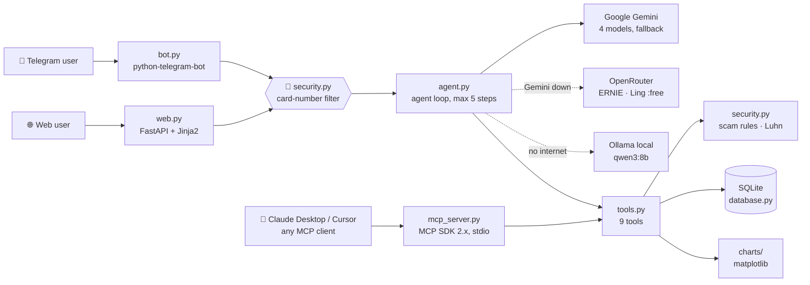
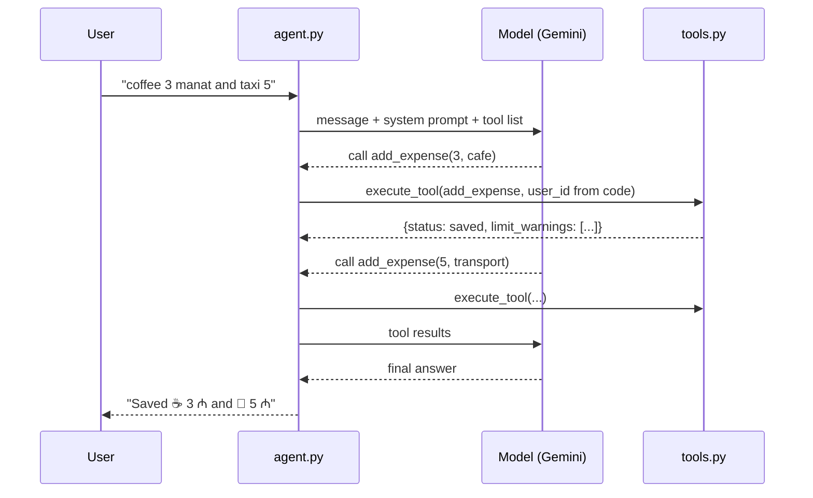

<p align="center">
  
</p>

<h1 align="center">Fintra</h1>
<p align="center"><b>Sayır · Planlayır · Qoruyur</b> — Count · Plan · Protect</p>
<p align="center">
  An AI finance agent in Telegram, on the web and in any MCP client.<br>
  Built for the <i>"Agentic AI: From Models to Systems"</i> workshop (IMechE ASOIU Student Chapter, UFAZ).
</p>

<p align="center">
  🤖 Telegram: <a href="https://t.me/myfintra_bot">@myfintra_bot</a> ·
  🎬 Demo video: <i>(link)</i> ·
  🔐 <a href="#-security--privacy">Security first</a>
</p>

> 🇦🇿 **Fintra** — xərclərinizi mətn, çek şəkli və səslə yazan, maaşınıza görə plan quran və sizi fırıldaqçı SMS-lərdən qoruyan AI maliyyə agentidir. Telegram-da, saytda və MCP vasitəsilə istənilən AI-da işləyir.
>
> 🇷🇺 **Fintra** — AI-агент по финансам: записывает расходы текстом, фото чека и голосом, строит план от зарплаты и защищает от мошеннических SMS. Работает в Telegram, на сайте и в любом AI через MCP.

---

## 📌 The problem

Most people do not know where their money goes until the month is over. Spreadsheets and finance apps need manual input, so people stop using them after a week. At the same time, **bank-card fraud through fake SMS** ("your card is blocked, send the code") is common in Azerbaijan, and complaints about it regularly appear on platforms like sikayet.az.

Fintra solves three things in one place, in the language the user speaks (🇦🇿 / 🇷🇺 / 🇬🇧):

| | What it does |
|---|---|
| **Sayır — Count** | Add an expense by typing *"coffee 3 manat"*, sending a **receipt photo** or a **voice note**. See totals and a donut chart. |
| **Planlayır — Plan** | Build a monthly plan from salary and fixed payments. The agent *suggests* saving 20%, **the user decides**. Shows how much can be spent today. Limits on categories and on card **names**. |
| **Qoruyur — Protect** | Checks suspicious SMS and links. Blocks card numbers. Removing a limit or deleting data always needs **human confirmation**. |

**Survey:** *(results from 15+ respondents will be added here)*

---

## 🏗 Architecture



**One set of tools, three entry points.** The Telegram bot, the website and the MCP server all call the same functions in `tools.py`, so every security check works the same way everywhere.

### The agent loop



- The loop is written by hand (`automatic_function_calling` is disabled), so the code — not the model — inserts the `user_id`, shows each step to the user, and stops after 5 steps.
- The web chat shows the agent's steps as chips (`🔧 add_expense`), an idea taken from **DeepSeek Harness** (seeing every step of the agent).

### Tools (9)

| Tool | Purpose | Changes data? |
|---|---|---|
| `add_expense` | Save one expense (text, photo, voice) | ✅ |
| `get_summary` | Totals by category: today / week / month / all | — |
| `make_chart` | Donut chart in Fintra colors | creates image |
| `plan_budget` | Monthly plan: income − fixed payments − savings | ✅ |
| `get_daily_allowance` | How much can be spent today until payday | — |
| `set_limit` | Limit on a category or a card **name** | ✅ |
| `list_limits` | Show limits | — |
| `request_remove_limit` | **Does not remove!** Only creates a request the human must confirm | — |
| `check_scam` | Rule-based scam check + explanation | — |

### Model fallback chain

```
Gemini 3.7 Flash → 3.6 Flash → 3.5 Flash → 3.5 Flash-Lite
      ↓ all failed (429 / 500 / 503 / timeout)
OpenRouter: Baidu ERNIE 5.5 Flash :free → inclusionAI Ling 3.2 Flash :free
      ↓ failed or no internet
Ollama (local): qwen3:8b — data never leaves the computer
```

If Gemini fails **in the middle** of a task (for example, after an expense was already saved), the backup model receives the steps that were already done, so nothing is saved twice. Photos and voice notes need Gemini; in backup mode the bot politely asks to type the message.

### Photos, voice and memory

- **Photos and voice notes go straight to Gemini** as files (`image/jpeg`, `audio/ogg`) in the same request as the text; there is no separate OCR or speech-to-text step. Gemini reads the receipt or the voice note and calls the same tools.
- In backup mode (OpenRouter / Ollama) only text is supported, so the bot asks the user to type the expense.
- **No chat history is stored.** Each message is handled on its own with the system prompt and the tools; facts that matter (expenses, plan, limits) live in the database, not in a conversation log. This keeps requests small and private. The trade-off: the agent does not remember the previous message, so multi-step dialogs (like building a plan) ask for all details in one message or step by step through the tools.
- **SQLite** runs in WAL mode, every operation opens a short connection and every query is scoped by `user_id`. That is enough for a contest-scale load; a real launch would move to PostgreSQL.
---

## 🔐 Security & Privacy

Personal financial data is sensitive, so security was the first requirement, not an add-on.

**Data we never take**
- 💳 **Card numbers are blocked before they reach the AI.** Numbers are detected with the **Luhn algorithm**; in Telegram the message is deleted from the chat. Limits are set on card *names* ("Birbank"), never numbers.
- No CVV, PIN, SMS codes, passwords or bank logins. Fintra has no access to bank accounts and cannot make payments.
- Chat history, receipt photos and voice notes are not stored.

**The AI cannot do dangerous things alone**
- 🙋 **Human-in-the-loop:** removing a limit or deleting all data requires a button press. Pending confirmations live on the server with a random token, a 5-minute TTL and an owner check.
- 🧱 **Prompt-injection rule:** text inside photos, voice notes and forwarded messages is treated as *data*, never as instructions.
- 🚨 **Hybrid scam check:** rules in code (secret-code words, urgency, prizes, link shorteners, fake bank domains) set the **minimum** risk level. The model only explains it and **cannot lower** the risk. The warning banner is added by code.

**Web & storage**
- 🔗 **No passwords:** login only by a one-time link from the bot (`secrets.token_urlsafe(32)`), stored as a **SHA-256 hash**, valid 10 minutes, burned atomically on first use.
- 🍪 Sessions stored as hashes, 24 h; cookies `HttpOnly`, `SameSite=Lax`, `Secure` on HTTPS.
- 🧍 Every SQL query is parameterized and scoped by `user_id` (no IDOR); a user can only touch their own rows.
- 🛡 Chat output is inserted with `textContent` (no XSS); chart files are served only to their owner (`os.path.basename`, no path traversal); deletes use POST + Post/Redirect/Get; public FastAPI docs (`/docs`) are disabled; the language parameter accepts only `az/ru/en`.
- 🗑 **User control:** `/delete_my_data` in Telegram or the Security page (type `DELETE` + confirm) removes expenses, plan, limits, charts and sessions. "Log out on all devices" is one click.
- 🔑 **No secrets in the repo:** keys live in `.env` (git-ignored); the whole git history was checked for leaked keys. The OpenRouter key has a $0 credit limit and expires after the contest.
- 🧪 OpenRouter providers that may train on user data were **disabled**; a free model whose provider may train on prompts was rejected.
- 📜 A public **Privacy Policy** (`/privacy`, 3 languages) explains what is stored, who processes it and how to delete it.

---

## 🔌 MCP server

`mcp_server.py` exposes Fintra to **any MCP client** (Claude Desktop, Cursor, VS Code, Gemini CLI, OpenCode). It uses all three MCP primitives:

- **Tools:** `add_expense`, `get_summary`, `make_chart`, `get_daily_allowance`, `list_limits`, `set_limit`, `check_scam`
- **Resource:** `fintra://categories`
- **Prompt:** `monthly_review`

Safety: local **stdio** only (no open port), the user ID comes from `.env` and not from the model, every tool is annotated read-only or write, and **destructive actions are not exposed** over MCP at all.

```json
{
  "mcpServers": {
    "fintra": {
      "command": "/path/to/finance-agent/venv/bin/python",
      "args": ["/path/to/finance-agent/mcp_server.py"]
    }
  }
}
```

Tested with **MCP Inspector** (`npx @modelcontextprotocol/inspector python mcp_server.py`) and **Claude Desktop**: asking *"How much did I spend this month?"* makes Claude call Fintra's `get_summary`; a fake bank SMS returns **high risk** from Fintra's rules.

> Note: when Fintra is used through a cloud AI client, tool results are processed by that client's provider.

---

## 🧰 Workshop tools I used

| Tool | How it was used in Fintra |
|---|---|
| **Google AI Studio** | Gemini API key, testing prompts |
| **Meta-prompting** (AI asks questions first) | The system prompt (`prompts.py`) was built by answering the AI's questions about role, tone, language and safety |
| **Google Stitch** | Dashboard design; exported HTML became the Jinja templates (`web/stitch/`) |
| **Gemini** | Logo (half-coin + arrow + bars) |
| **OpenRouter / Z.ai GLM** | Free backup models; GLM 4.5 Air was tested but its free version had no tool calling |
| **Ollama** | Local private backup (`qwen3:8b`), works offline |
| **MCP** | `mcp_server.py`, tested with MCP Inspector and Claude Desktop |
| **DeepSeek Harness idea** | Showing every agent step in the web chat |
| **LMArena** | Blind comparison of models on real Fintra tasks (see below) |
| **NotebookLM** | Read the README as a "jury": it summarized Fintra correctly and pointed out gaps (no metrics, unclear multimodal flow and memory), which led to the evaluation script and the sections below |
| **Lovable / v0** | Considered; not used because Fintra needs a real Python backend. I chose the code path (level 3 of the workshop's three levels). |

### LMArena: blind model comparison

I tested anonymous models on two real Fintra tasks in **Battle mode** (names are hidden until you vote).

| Task | Models (revealed after voting) | Result |
|---|---|---|
| Parse expenses from mixed Azerbaijani / Latin text: *"kofe 3 manat, taksi 5.5, Bravo-da 12 manat ərzaq aldım"* | inkling-2-small vs inkling-2-small | Both correct: 3 expenses, 5.5 understood, "Bravo … ərzaq" → groceries. Both wrote the currency as `"manat"`, not `AZN`. |
| Is this SMS a scam? *"Kartınız bloklanıb. Kodu göndərin: kapitalbank-az-secure.com"* | deepseek-v4.1-flash-high vs **gemini-3.8-flash-high** | Both detected phishing; **Gemini** was better: it named all three red flags (urgency, fake domain vs. `kapitalbank.az`, request for a code). |

**What it changed in Fintra**
- The currency is never left to the model: `AZN` is the default in code and the system prompt uses ₼.
- Models are good but not equally complete, so the scam check is **hybrid**: rules in code set the minimum risk, the model only explains it.
- In a blind test a Gemini model gave the most complete answer, which supports Gemini as Fintra's main model.
---

## 🚀 Run it yourself

```bash
git clone https://github.com/jalya07/Fintra.git
cd Fintra
python3 -m venv venv && source venv/bin/activate
pip install -r requirements.txt
cp .env.example .env      # fill in your own keys
```

| Variable | What it is |
|---|---|
| `TELEGRAM_BOT_TOKEN` | From @BotFather |
| `GEMINI_API_KEY` | From Google AI Studio |
| `GEMINI_MODELS` | Comma-separated, strongest first |
| `OPENROUTER_API_KEY`, `OPENROUTER_MODELS` | Optional cloud backup (free models with tool support) |
| `OLLAMA_MODELS`, `OLLAMA_URL` | Optional local backup, e.g. `qwen3:8b` |
| `WEB_URL` | Public address of the website (used in `/web` login links) |
| `FINTRA_USER_ID` | Your Telegram ID, only for the MCP server |

```bash
python bot.py                                     # Telegram bot
uvicorn web:app                                   # website on http://127.0.0.1:8000
cloudflared tunnel --url http://127.0.0.1:8000    # optional: public HTTPS address
```

Open the website by sending `/web` to the bot.

### Project structure

```
bot.py          Telegram bot: commands, text, photo, voice, confirmations
agent.py        Agent loop + Gemini → OpenRouter → Ollama fallback
tools.py        9 tools and their JSON schemas
prompts.py      System prompt (role, language, format, safety rules)
security.py     Luhn card check, scam rules, risk banners
database.py     SQLite: expenses, budgets, limits, login tokens, sessions
web.py          FastAPI website + web chat API
i18n.py         AZ / RU / EN translations
mcp_server.py   MCP server for Claude Desktop and other clients
web/templates/  Pages (Overview, Expenses, Plan & Limits, Chat, Security, Privacy)
web/stitch/     Original Google Stitch export (design source)
```

---

## 🧗 Where I got stuck

Real problems from development and how they were solved.

**Telegram & environment**
- `Conflict: terminated by other getUpdates request` — two copies of the bot were running. Found the old process with `ps aux | grep bot.py` and stopped it.
- The command menu did not appear — `set_my_commands` must run in `post_init`.
- `TimedOut` on start — slow network; added 30 s connect/read timeouts and `bootstrap_retries=5`.
- The bot printed a Python tuple instead of a picture — after `run_agent` started returning `(reply, images)`, `bot.py` still expected one value.

**Gemini & the agent**
- `503 overloaded` made the bot hang — moved the model list to `.env`, added a fallback loop, a 15 s timeout and `concurrent_updates`.
- A new system prompt "did not work" — an old `build_system_prompt` inside `agent.py` shadowed the imported one, and the old process was still running.
- The model wrote Markdown asterisks and invented a `/limits` command — added prompt rules plus a `clean_reply()` safety net.
- **Backup models:** the free GLM 4.5 Air on OpenRouter had no tool calling, so it could not save expenses. Filtered OpenRouter by *free + tools* and picked ERNIE and Ling; rejected a model whose provider may train on prompts.
- **Ollama:** `qwen3.5:4b` did not call tools and still *claimed* the expense was saved — dangerous for a finance app. `qwen3:8b` works correctly. Its "thinking mode" made answers take minutes; `think=false` is ignored by the OpenAI-compatible endpoint, `reasoning_effort: "none"` works.
- A `.env` line was accidentally commented out, so the backup list was empty — wrote a small diagnostic script that prints only *whether* variables are set, never their values.

**Design & website**
- Google Stitch invented features we do not have (encryption enclave, bank sync, investments, CSV export) — removed them with "truth-pass" prompts so the UI never promises something false.
- Google Translate translated icon names (`dashboard` → text) — added `translate="no"` to icons and the brand name.
- `404` on every page — `python-multipart` was missing, so FastAPI failed at the first `Form` route.
- The chart kept old colors — browser cache; added `?v=timestamp` and `Cache-Control: no-store`.
- `UndefinedError: 'data' is undefined` — the new template was deployed before the backend that passes `data`.
- New database functions were "missing" — they had been pasted **inside** the `if __name__ == "__main__":` block, so they did not exist on import. Python indentation is part of the syntax.
- **Translation:** seven templates by hand would be slow and error-prone, so `i18n.py` uses English text as the key and falls back to English if a translation is missing — the site never breaks.

**MCP**
- Tutorials use `FastMCP`, but **MCP SDK 2.x** renamed it to `MCPServer` — checked the installed version first.
- An MCP host starts the server from any folder, so the database was not found — the server now `chdir`s to the project folder.
- `stdout` belongs to the MCP protocol, so errors are printed to `stderr`.
- Claude Desktop's config already had app settings; instead of editing JSON by hand (one missing comma breaks it), a small script added the server with Python's `json` module and made a backup first.

---

## ⚠️ Limitations (honest list)

- During the contest Fintra runs on my laptop and is published through a Cloudflare quick tunnel: the laptop must be on, and the tunnel address changes on restart (the QR code points to the bot, which always gives the current link).
- The local Ollama model sometimes answers in a different language; it is the last backup level only.
- Fintra is not a bank and gives no investment, legal or tax advice.

---

<p align="center">Made by <b>Jale Hasanli</b> · <a href="https://github.com/jalya07">@jalya07</a></p>
